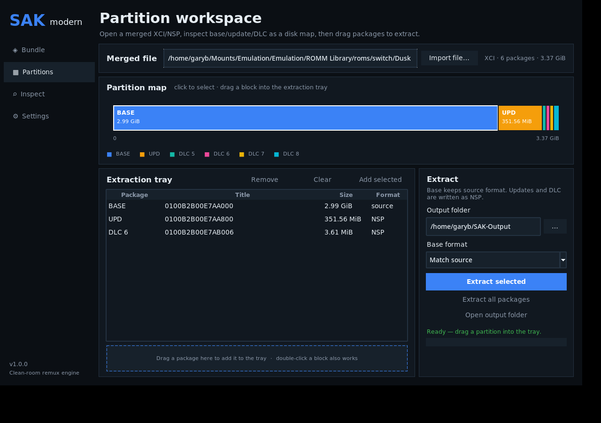
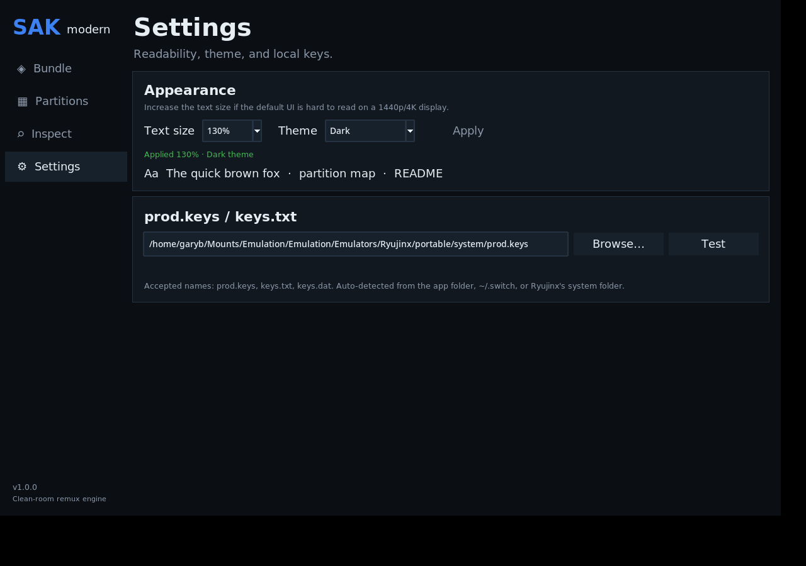
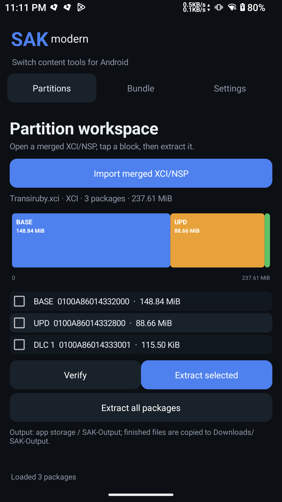

# SAK Modern

A cross-platform, clean-room replacement for the content pipeline in
[Switch Army Knife (SAK)](https://github.com/dezem/SAK). It bundles a base game,
its update, and DLC into one **XCI** or **NSP**, and can apply a newer update to
an already-merged file without duplicating the old content.



## What it does

- **Bundle** base + update + DLC into one XCI or NSP.
- **Re-bundle** an existing merged XCI/NSP with a newer update or additional DLC.
  The old update package and matching DLC package are replaced, not appended.
- **Partition workspace**: import an already-merged XCI/NSP, see base/update/DLC
  as a proportional disk-style map, drag a block into the extraction tray, and
  export that package as a separate file.
- **Inspect** title IDs, content types, key generations, and package boundaries
  in a sortable table.
- **Verify** container structure, HFS0 SHA-256 hashes, NCA header sizes, and
  gamecard capacity.
- **Readable UI controls**: 100% / 115% / 130% / 150% text sizing, and Dark,
  Light, or High-contrast themes. `Ctrl` + `+` / `-` / `0` also changes text size.
  The window auto-fits the desktop resolution.
- **Dolphin-style file picker** with a places sidebar, Name/Size/Modified/Type/
  Permissions columns, sortable headers, a details pane, a hidden-file toggle,
  filters, and auto-sized columns.
- **Convert** implicitly: choose an XCI base + `NSP` output, or an NSP base +
  `XCI` output.
- Handles both 512-byte-aligned and non-aligned source PFS0 files.
- Correct **8/16/32 GiB gamecard sizing**, including the 16 GiB boundary that
  the Bayonetta 3 base+update bundle lands on.

## Source and releases

- Source: <https://github.com/pwnedbygary/sak-modern>
- Releases: <https://github.com/pwnedbygary/sak-modern/releases>

## Downloads / builds

- Linux: `SAK-Modern-x86_64.AppImage` (self-contained; no Wine).
- Windows: `SAK-Modern.exe` / `SAK-Modern-Windows-x86_64.zip`.
- Android: `SAK-Modern.apk` (native Java UI + Chaquopy Python core).

Prebuilt binaries are attached to the GitHub
[Releases](https://github.com/pwnedbygary/sak-modern/releases) page.

From source:
  ```bash
  python -m pip install -e .
  sak-modern gui
  ```

The Linux AppImage is built with `scripts/build_appimage.sh`; the Windows
executable with `scripts/build_windows.ps1`. The Android APK is built from
`android/` with Gradle + Chaquopy.



## Android

The APK uses a native Android UI, not Tkinter. Import a merged XCI/NSP, tap a
partition block, and extract it; finished files are copied to
`Downloads/SAK-Output`. See [android/README.md](android/README.md).



## Keys

Put `prod.keys` (or `keys.txt`) next to the executable, in `~/.switch`, or select
it in **Settings**. Keys are read locally and never uploaded. The app needs the
`header_key`, the relevant `titlekek_XX`, and master-key material only when it
must rewrite a title-key NCA for XCI output. Bundling already-ticketless content
does not need those keys.

No keys or game content are included in this repository or the binaries.

## CLI

```bash
# Inspect a file
sak-modern inspect game.xci --keys ~/.switch/prod.keys

# Bundle base + update + DLC into XCI
sak-modern bundle \
  --base "Game.xci" \
  --add "Game [Update].nsp" \
  --add "Game [DLC 1].nsp" \
  -o ~/SAK-Output --format xci --keys ~/.switch/prod.keys

# Apply a newer update to an already-merged XCI, producing NSP
sak-modern bundle --base "Game (1G+1U+4D).xci" \
  --add "Game [v2.0.0].nsp" -o ~/SAK-Output --format nsp

# Split a merged file into base/update/DLC packages
sak-modern extract "Game (1G+1U+4D).xci" -o ~/SAK-Output --keys ~/.switch/prod.keys

# Verify structure and hashes
sak-modern verify ~/SAK-Output/Game.xci --keys ~/.switch/prod.keys
```

## XCI vs NSP (important for DLC)

- **NSP** keeps the original tickets and rights IDs. This is the right output for
  installers (DBI/Tinfoil) and for emulators such as Ryujinx/Yuzu. DLC ownership
  metadata is preserved.
- **XCI** is the gamecard-style container. A multi-content XCI is useful for
  USB/HDD loading and for installers that scan the secure partition. Standard XCI
  secure partitions do not carry tickets, so the app converts rights-based NCAs
  to ticketless key-area form, exactly like the established SAK/NSC_BUILDER
  behavior. On CFW this needs working sigpatches; some installers/tools will
  still not treat embedded DLC as owned content.

Emulators do **not** read update/DLC content out of a multi-content XCI. Our
Ryujinx test loaded the merged XCI as the base game, then loaded the update and
all four Dusk Diver DLCs from the separate NSPs in the library — not from the
XCI. If your goal is a single file for an emulator, use the **NSP** output; if
your goal is one file for USB/gamecard-style loading, use **XCI**.

## Why the old SAK failed on some games

The shipped SAK 0.7.14 is an AutoIt GUI around **NSC_BUILDER 0.98b**
(`squirrel.exe`, PyInstaller/Python 3.7). Its update path is essentially:

```text
squirrel.exe -b 65536 -pv false -kp false --RSVcap 268435656 \
  -fat exfat -fx files -ND true -t xci -o ...\squirrel \
  -tfile ...\squirrel\list.txt -roma TRUE -dmul calculate
```

The list contains the base XCI followed by every selected NSP. The old pipeline
extracts and rebuilds the whole container through Windows-only tools.

Findings from the two examples:

- **Dusk Diver** (base XCI + update + 4 DLC) merged successfully under Wine. The
  output was 3,614,426,624 bytes, 18 NCAs. Its update/DLC NCAs had their rights
  IDs cleared and their title keys rewrapped into the key area; it contained no
  tickets. Ryujinx booted the base from that XCI but loaded the update and all
  DLC from separate NSP files. This is the most likely reason “DLC doesn’t work”
  in an emulator: the emulator ignores embedded add-on content in an XCI.
- **Bayonetta 3** (base XCI + 2.09 GiB update) merged successfully and produced
  a 17,085,348,864-byte XCI on a **16 GiB** card (`0xE1`). It was not a 16 GiB
  overflow. Its update NSP also has a non-512-aligned PFS0 data start
  (`0x1FE`), which some old readers handle inconsistently.
- The old 0.98b multi-content path also has known list/DLC selection and stale
  ticket/certificate bugs. Those are fixed by planning per title package instead
  of flattening everything into a text list.

SAK Modern avoids the whole class of problems by parsing PFS0/HFS0/NCA directly,
using the CNMT boundary to keep packages together, realigning output to 512
bytes, and verifying the result.

See [MODERNIZATION.md](MODERNIZATION.md) for the full reverse-engineering
notes and evidence, and [docs/library-migration.md](docs/library-migration.md)
for the batch library tool, [docs/partition-workspace.md](docs/partition-workspace.md)
for the visual splitter, [docs/file-picker.md](docs/file-picker.md) for the
picker, [docs/appearance.md](docs/appearance.md) for readability settings, and [docs/migration-results.md](docs/migration-results.md)
for the completed run results.

## Development

```bash
python -m venv .venv
. .venv/bin/activate
pip install -e '.[dev]'
pytest -q
python -m sak_modern.gui
```

Project layout:

```text
src/sak_modern/core/   container parsers, crypto, bundle planner/writers
src/sak_modern/gui.py  Tk desktop UI
src/sak_modern/cli.py  command line
tests/                 synthetic format/crypto/planning tests
scripts/               AppImage and Windows build scripts
```

## Current scope and limitations

- NSZ/XCZ compressed inputs are detected and rejected with a clear message;
  decompress them first.
- This is a content remuxer, not a generic SAK clone: XCI trimming, firmware
  extraction, savegame extraction, NRO forwarders, and SD formatting are not
  implemented.
- Structural verification checks container hashes and NCA headers. It does not
  perform RSA signature validation or decrypt every NCA section.
- Use only with games and keys you are legally entitled to use.
